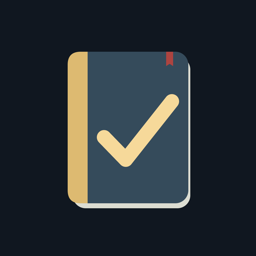
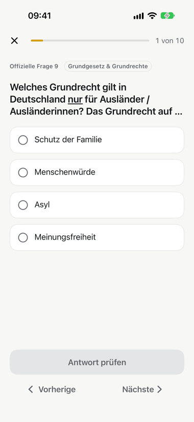
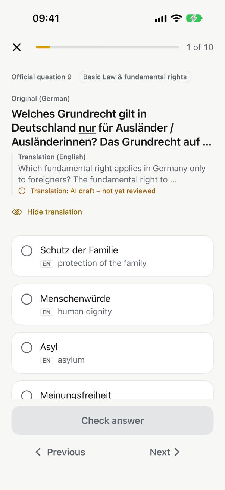
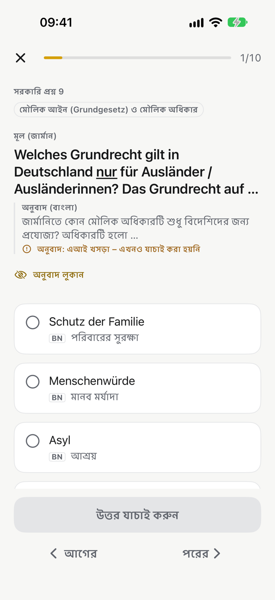
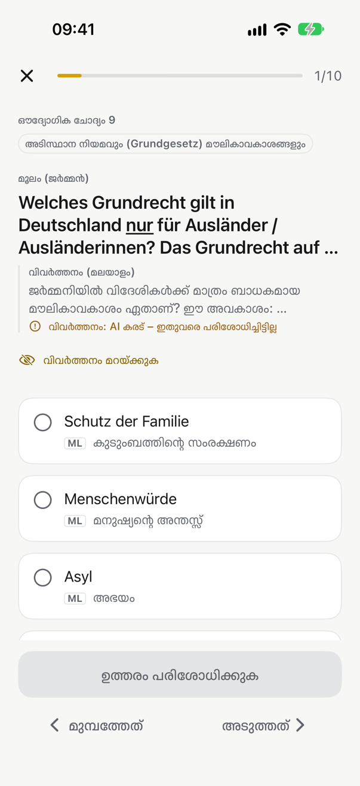
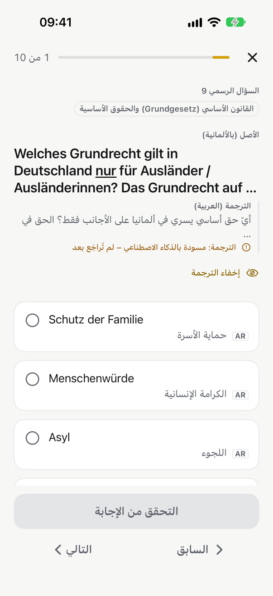
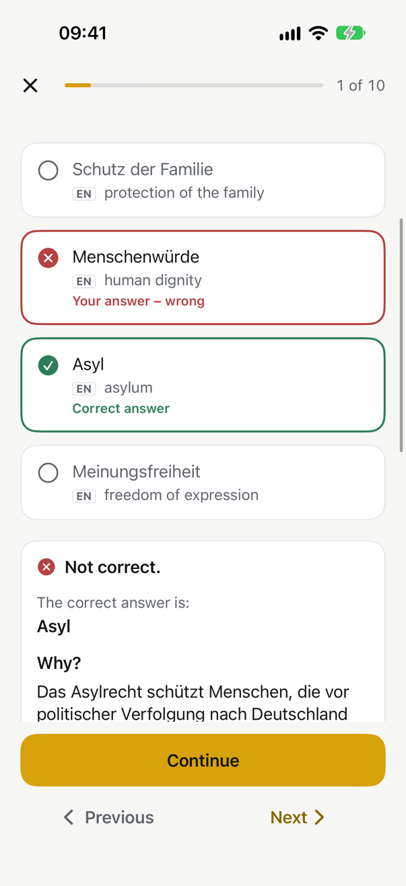
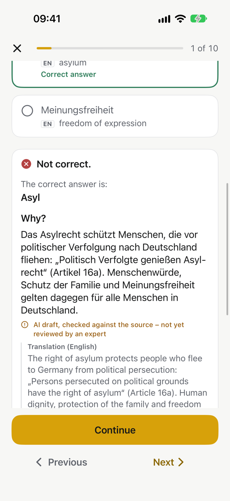
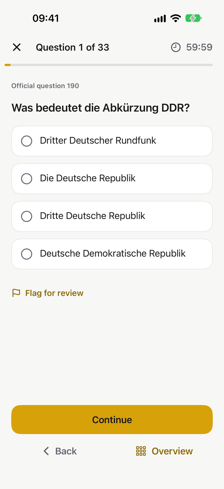
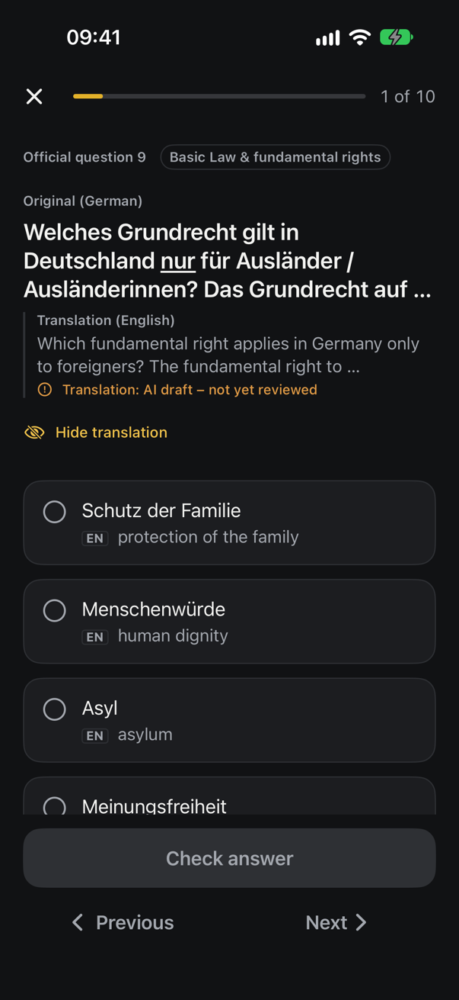

  

<h1 align="center">EinBürger Coach</h1>

  An iPhone app for preparing for Germany's citizenship test (<i>Einbürgerungstest / Leben in Deutschland</i>). 
  <b>The official German questions, explained in your language.</b>

  Personal project · SwiftUI · iOS 17+ · 8 languages · not released

---

## Why I built it

When I prepared for my own test, I kept translating everything just to understand the question: single words, whole sentences, answer options, legal and political terms. I was spending more time translating than learning.

So I built the app I wished I had.

## The idea

The test is taken in German, so the app never replaces the German. Every official question and its answers appear **exactly as in the official catalogue, always German and always first**. Underneath sits a help layer in your language.

- **Help under the German:** a translation of the question and of every answer option.
- **Know why, not just what:** after each answer, an explanation of why it's right, in German and in your language.
- **8 app languages:** Deutsch, English, Türkçe, العربية (right to left), Українська, Русский, বাংলা and മലയാളം.
- **A realistic mock exam:** German only, like the real test. Help and explanations come back afterwards, in the mistake review.

The animation shows the same official question in all eight app languages. The German never changes; only the help underneath does.

 

## Screens

<table>
  <tr>
    <td></td>
    <td></td>
    <td></td>
    <td></td>
  </tr>
  <tr>
    <td align="center">English help</td>
    <td align="center">Bengali help</td>
    <td align="center">Malayalam help</td>
    <td align="center">Arabic, right to left</td>
  </tr>
  <tr>
    <td></td>
    <td></td>
    <td></td>
    <td></td>
  </tr>
  <tr>
    <td align="center">A wrong answer, corrected</td>
    <td align="center">"Why?" in German + your language</td>
    <td align="center">Mock exam: German only</td>
    <td align="center">Dark mode</td>
  </tr>
</table>

## Features

- **Placement test:** a short diagnostic, then an explainable readiness estimate from 0 to 100 that shows how it's calculated and never promises a pass.
- **Daily plan with spaced repetition:** wrong answers come back soon, well-known questions later.
- **Learning by topic:** six topics plus the questions for your federal state, covering all 16 states.
- **Mistake review and saved questions.**
- **Mock exam like the real one:** 33 questions (30 general + 3 for your state), 60 minutes, pass at 17. German only, with no hints during the exam.
- **Exam countdown** for your test date.
- **Accessibility:** dark mode, Dynamic Type up to the largest sizes, and right-to-left layout for Arabic.
- **Privacy:** works offline, with no account, no tracking and no analytics.

## Content you can trust

A beautiful wrong answer is worse than none, so the content pipeline came first.

- **417 official questions** (289 general + 8 for each of the 16 states):
  - **Text:** parsed from the official question catalogue (Annex 1 of the EinbTestV ordinance).
  - **Answers:** every correct answer verified one by one against the BAMF Online-Testcenter.
- **43 image questions held back** (coats of arms, maps, photos) until the reuse rights for the images are cleared.
- **Explanations that cite their sources:** every quote is checked against the primary source, such as the Basic Law, state constitutions or official statistics.
- **Honest translations:**
  - They're AI drafts, labelled in the app as "AI draft – not yet reviewed".
  - A review document exists for each language.
  - Nothing is marked as human-reviewed without a real native reviewer.
- **A release gate:** the build refuses to ship incomplete or unverified content.

## Engineering

- **Architecture:**
  - A SwiftUI app on top of a local Swift package, **CoachKit**, that holds the domain logic. It's testable without a simulator and covers practice sessions, the study planner, spaced repetition, the readiness model and the mock-exam engine.
  - **CoachContent** holds the bundled, validated question pack.
  - **CoachPersistence** holds learner progress in SwiftData.
- **Localization:**
  - A String Catalog with 491 interface strings in 8 languages, with full plural rules (including the Ukrainian and Russian *few/many* forms) and right-to-left support.
  - Tooling checks every translation, including placeholder order. That check came from a real crash a reordered placeholder caused.
- **Tests:**
  - 300+ unit tests in the package.
  - 59 UI tests that walk through the whole app in all 8 languages, at large text sizes and in dark mode.
- **Privacy and security:** a privacy manifest that declares no collected data, and an automated security scan of the release binary.
- **Size:** about 23,000 lines of Swift (app, package and tests).

## Status

This is a personal project and has not been released. The source code is private; I'm happy to walk through it on request.

---

Independent learning app. Not affiliated with the BAMF or any German authority.
The official question texts come from Annex 1 of the Einbürgerungstestverordnung (an official work, not protected by copyright under § 5 UrhG).
All screenshots are real, unedited captures from the iOS Simulator.
App design, icon, screenshots and text © 2026 vectorsingh. All rights reserved.

